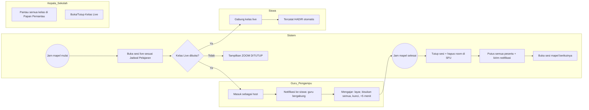
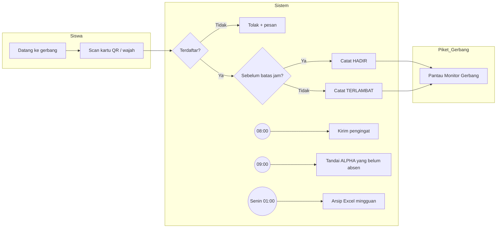
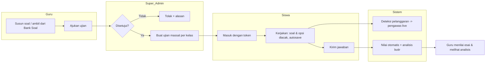
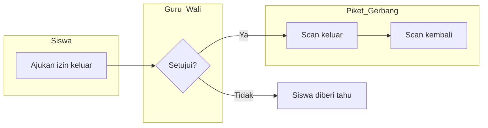
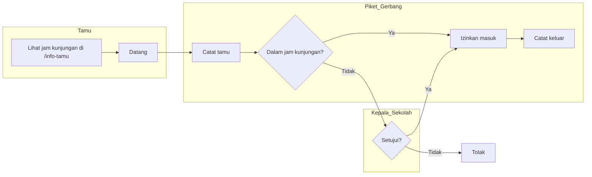
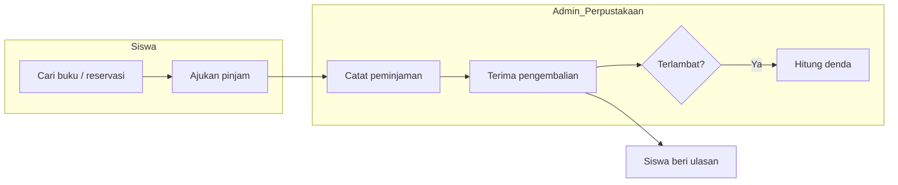
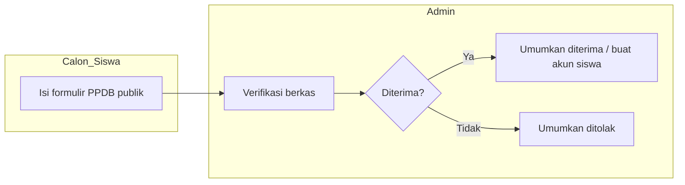

# BPMN — Alur Proses Bisnis Utama

Notasi: diagram alur gaya BPMN (swimlane = subgraph per pelaku). Dapat dilihat langsung di GitHub (mermaid).

## 1. Kelas Live Terjadwal

## 2. Absensi Gerbang (QR / Face ID)

## 3. Pengajuan & Pelaksanaan Ujian (Vortex Guard)

## 4. Izin Keluar (IK)

## 5. Kunjungan Tamu

## 6. Peminjaman Buku

## 7. PPDB

