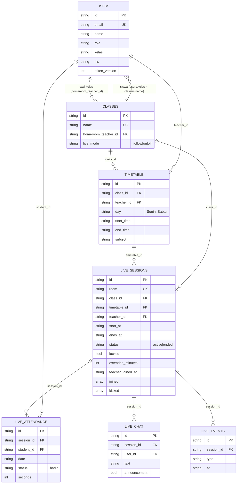
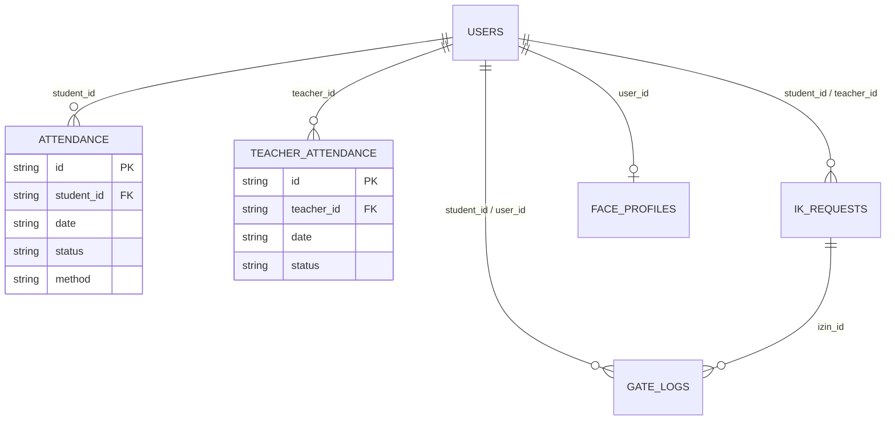
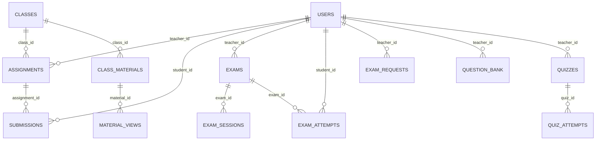
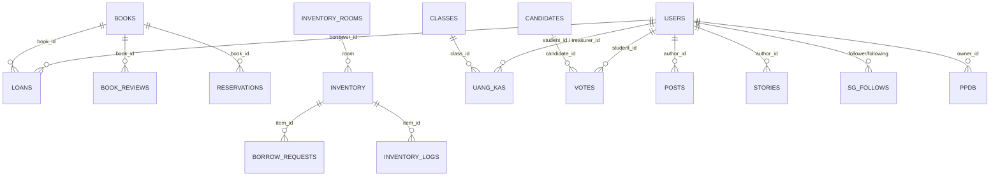

# ERD — Entity Relationship Diagram (MongoDB)

MongoDB tidak memakai foreign key; relasi di bawah adalah relasi logis lewat field `*_id` (UUID string) dan
`kelas` (nama kelas pada akun siswa). Diagram dibuat dari source code (`server.py`, `live_class.py`).

## 1. Inti: Pengguna, Kelas, Jadwal, Kelas Live

`live_settings` (dokumen tunggal `id="global"`, field `enabled`) mengatur buka/tutup seluruh sekolah.

## 2. Absensi

Pendukung: `attendance_stations`, `attendance_archives`, `attendance_confirm_tokens`, `gate_settings`, `piket_shifts (teacher_id)`, `guests`, `guest_hours`.

## 3. Pembelajaran & Ujian

Pendukung kelas: `class_schedule`, `class_agenda`, `class_announcements`, `class_seating`, `class_discussions`, `class_bph`, `report_notes`, `points`, `subjects`.

## 4. Administrasi & Sosial

Lainnya: `announcements`, `notifications`, `events`, `feedback`, `gallery`, `files` (metadata unggahan di disk), `org_structures`, `org_nodes`, `settings`, `library_config`, `election_config`, `social_fund`, `chat_messages`, `email_logs`, `cron_runs`, `audit_logs`, `login_attempts`, `password_reset_requests`, `password_reset_tokens`, `reset_requests`, `reschedules`, `profile_achievements`.
