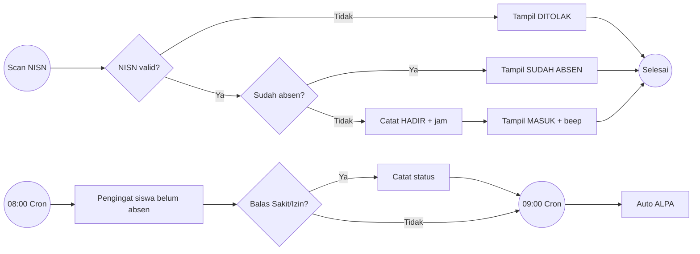
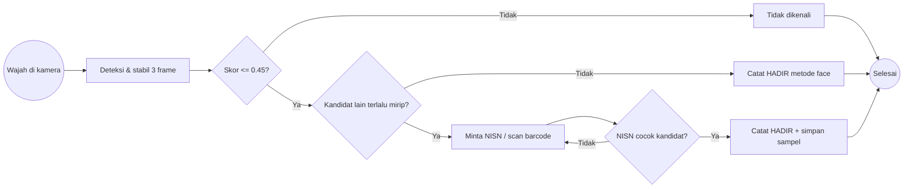
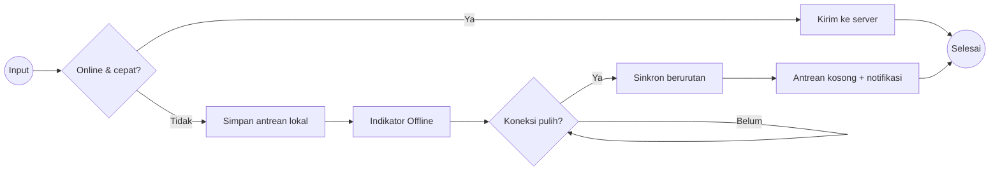

# 04 — BPMN (Proses Bisnis) — SMANSALA main17
Format: deskripsi pool/lane + langkah + diagram Mermaid (flowchart) yang dapat digambar ulang ke BPMN 2.0.
Simbol: (Start) mulai · [Tugas] · {Gateway keputusan} · (End) selesai.

## P1. Presensi Harian Barcode
**Lane:** Siswa · Scanner/Layar Gerbang · Sistem (Backend) · Cron · Wali Kelas/Kepsek
1. (Start) Siswa tiba di gerbang dan men-scan barcode NISN di Kartu Pelajar.
2. Sistem mencari siswa berdasarkan NISN. {Ditemukan & aktif?} Jika tidak, tampil DITOLAK (End).
3. {Sudah absen hari ini?} Jika ya, tampil SUDAH ABSEN. Jika tidak, catat HADIR + jam + stasiun, lalu tampil MASUK dengan bunyi beep.
4. 08:00 Cron mengirim pengingat ke siswa yang belum absen. Siswa bisa klik Sakit/Izin dan status tercatat.
5. 09:00 Cron menandai siswa tanpa catatan sebagai ALPA.
6. Senin 01:00 Cron mengarsipkan rekap mingguan.
7. Wali kelas/Kepsek melihat rekap & grafik mingguan, lalu ekspor (End).

## P2. Presensi Wajah + Konfirmasi Wajah Mirip/Kembar
**Lane:** Siswa · Kamera/Browser · Sistem · Operator
1. (Start) Siswa berdiri di depan kamera. Browser mendeteksi 1 wajah, cukup dekat, dan (opsional) berkedip.
2. Cincin Face ID terisi selama 3 frame stabil, lalu kode wajah dikirim ke server.
3. Sistem menghitung skor tiap siswa (rata-rata 3 sampel terdekat). {Skor ≤ 0,45?} Jika tidak, "Wajah tidak dikenali" dan cincin bergetar merah (End).
4. {Kandidat kedua terlalu dekat atau ditandai kembar?} Jika ya, tampil panel kandidat dan siswa scan barcode/ketik NISN.
   - {NISN termasuk kandidat?} Jika ya, catat HADIR (metode face) dan simpan sampel baru untuk belajar. Jika tidak, tolak dan minta ulang.
5. Jika tidak ambigu, catat HADIR dan tampil centang hijau (End).

## P3. Pendaftaran Wajah Siswa
1. Operator memilih siswa (atau Mode Per Kelas), lalu kamera merekam 5 pose.
2. {Sampel konsisten?} Jika tidak, ulangi.
3. {Mirip siswa lain (< 0,42)?} Jika ya, admin konfirmasi "siswa berbeda/kembar". Kedua profil ditandai mirip.
4. Simpan profil (atau tambah sampel ke profil lama). Pada Mode Per Kelas, lanjut ke siswa berikutnya.

## P4. Hapus Riwayat Absensi Hari Ini
**Lane:** Super Admin/Admin Absensi · Sistem
1. Operator klik ikon hapus pada baris atau tombol "Hapus Semua Hari Ini".
2. {Peran diizinkan?} Jika tidak, 403. {Tanggal = hari ini?} Jika tidak, tolak.
3. Konfirmasi (hapus semua: ketik "HAPUS"), lalu data dihapus dan dicatat di audit log. Siswa bisa scan ulang.

## P5. Mode Offline & Sinkronisasi
**Lane:** Pengguna · Aplikasi (browser) · Server
1. Pengguna melakukan input (absen, komentar, pesan, dll).
2. {Online & respons < 12 detik?} Jika ya, terkirim normal.
3. Jika tidak, simpan ke antrean lokal (dengan waktu asli). Indikator berubah menjadi "Offline", lalu tampil "Tersimpan offline".
4. Setiap 10 detik atau saat event "online": {Server bisa dihubungi?} Jika ya, kirim antrean berurutan. Item berhasil dihapus dari antrean, sedangkan item yang ditolak server (4xx) dibuang. Muncul notifikasi "n data tersinkron".

## P6. Piket Gerbang
Admin membuat jadwal shift, lalu cron mengirim pengingat ±30 menit sebelum shift. Guru check-in {terlambat >10 menit?} dan status tercatat, lalu check-out. Laporan bulanan + ekspor Excel.

## P7. Tugas / Kuis / Ujian Anti-Nyontek
Guru membuat dan siswa mengerjakan. Saat ujian, sistem mencatat pelanggaran (keluar tab/layar). Kuis dinilai otomatis, tugas dinilai guru. Hasilnya masuk ke poin & papan peringkat, lalu ke rapor.

## P8. Schoolgram
Ketua Kelas membuat post/story (bisa menandai kelas lain), lalu konten muncul di feed. Siswa like (ketuk dua kali), berkomentar, dan menyimpan. Story kedaluwarsa setelah 24 jam kecuali dijadikan Sorotan.

## P9. Uang Kas · P10. PPDB · P11. E-Voting · P12. Peminjaman · P13. Reset Password
- Kas: bendahara mencatat pembayaran. Tanggal 1 sistem mengirim pengingat ke yang menunggak.
- PPDB: calon siswa mengisi form + berkas, admin verifikasi, seleksi, pengumuman status.
- E-Voting: admin membuka pemilu, siswa memilih 1 kali, hasil real-time, admin menutup pemilu.
- Peminjaman buku/inventaris: ajukan → setujui → kembalikan → riwayat.
- Reset password: user mengajukan, admin setuju/tolak, user mengganti password.
