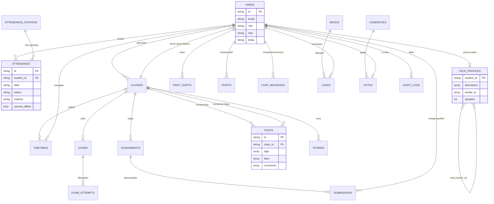

# 05 — ERD (Entity Relationship Diagram) — SMANSALA main17
Database: MongoDB (dokumen). Setiap dokumen memiliki `id` (UUID string) sebagai kunci, dan relasi memakai referensi id/nama kelas.
Flag `is_demo` memisahkan data demo dari data asli.

## 1. Entitas Inti & Atribut Utama
| Koleksi | Atribut utama | Relasi |
|---|---|---|
| users | id, name, email, password_hash, role, nisn, kelas, whatsapp, photo, qr_code, is_active, must_change_password | kelas → classes.name |
| classes | id, name, description, subjects[], homeroom_teacher_id, password, avatar, cover | homeroom → users |
| class_bph | id, class_id, parent_id, name, position | → classes, self (pohon) |
| subjects | id, name | — |
| attendance | id, student_id, student_name, kelas, date (YYYY-MM-DD WIB), status (hadir/izin/sakit/alpa), scanned_at, method (barcode/qr/manual/face/sistem), station_id, station_name, photo, scanned_by, synced_offline | → users (unik: student_id+date) |
| attendance_stations | station_id, name, operator, last_seen | 1–N attendance |
| attendance_archives | id, week, file, created_at | — |
| attendance_confirm_tokens | token, student_id, date | → users |
| face_profiles | student_id, descriptors[[128 float]] (≤30), samples, similar_to[student_id], photo, enrolled_by, updated_at | 1–1 users(siswa); N–N "mirip" ke face_profiles |
| timetable | id, class_id, day, start_time, end_time, subject, teacher_id, room | → classes, users(guru) |
| events, reschedules | kalender & jadwal ulang | → classes/users |
| piket_shifts | id, teacher_id, teacher_name, gate, date, start_time, end_time, checked_in_at, checked_out_at, notes | → users(guru) |
| assignments → submissions | tugas; nilai | assignments → classes; submissions → users |
| quizzes → quiz_sessions, quiz_attempts | kuis; percobaan | → classes, users |
| exams → exam_sessions, exam_attempts | ujian; pelanggaran | → classes, users |
| points | user_id, amount, reason, created_at | → users |
| uang_kas, social_fund | iuran/donasi | → classes, users |
| inventory → borrow_requests | aset; peminjaman | → users |
| books → loans, reservations, book_reviews; library_config | perpustakaan | → users |
| candidates → votes; election_config | pemilu OSIS | votes → users (1 suara) |
| posts | id, class_id, kelas, image, media_type (image/video), caption, tags[nama kelas], likes[user_id], comments[{id,user_id,user_name,text,created_at,edited}], author_id, created_at | → classes, users |
| stories | id, class_id, class_name, image, caption, highlighted, highlight_title, expires_at | → classes |
| chat_messages | id, from_id, to_id, text, created_at | → users ×2 |
| announcements, notifications, feedback | info & notifikasi | → users |
| report_notes | rapor & catatan wali | → users |
| gallery, profile_achievements | prestasi | → users |
| ppdb | pendaftar, berkas, status | — |
| org_structures, org_nodes | bagan organisasi | node → structure |
| settings | singleton: nama sekolah, logo, warna, kontak | — |
| reset_requests, password_reset_requests, password_reset_tokens, login_attempts | keamanan akun | → users |
| audit_logs | id, action, actor_id, target_user_id, meta, created_at | → users |
| cron_runs | run_id, job, created_at | idempotensi cron |
| files | metadata upload | — |

## 2. Diagram (Mermaid erDiagram)

## 3. Aturan Integritas Penting
- `attendance` unik per (student_id, date), sehingga scan bersamaan dari beberapa gerbang/wajah/offline tidak dobel.
- Barcode, QR, manual, wajah, dan sinkron offline menulis ke koleksi `attendance` yang sama.
- Hapus akun siswa juga menghapus `face_profiles` (pembersihan orphan otomatis).
- Data offline sementara ada di perangkat (localStorage `sk_offline_queue_v1`), bukan di database, sampai tersinkron.
